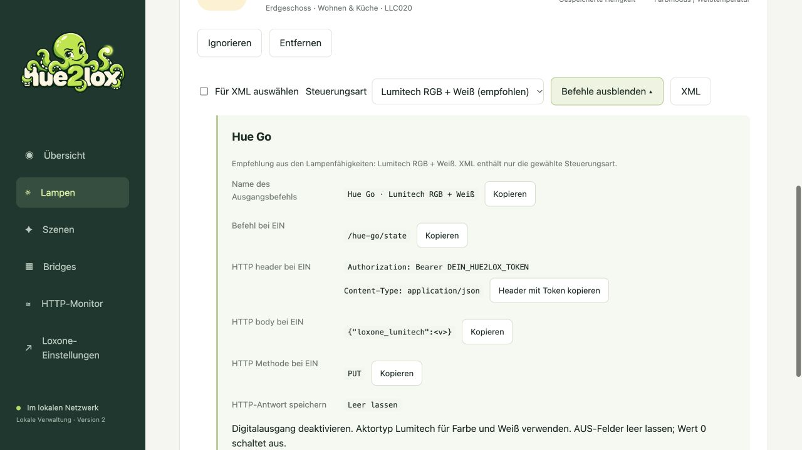

<a href="README.md">Deutsch</a> | <a href="README.en.md">English</a>

  

<h1 align="center">Hue im Griff. Mit Hue2Lox.</h1>

Philips Hue mit Loxone verbinden – lokal, übersichtlich und mit acht helfenden Armen.

<a href="docs/MANUAL.md">Handbuch</a> · <a href="INSTALL.md">Installation</a>

**Deine Hue-Lampen. Deine Loxone-Steuerung. Ein Ort für die Verbindung.**

Du möchtest deine Philips-Hue-Lampen in Loxone nutzen, ohne jeden HTTP-Befehl von Hand zusammenzustellen? Hue2Lox liest Lampen und Szenen deiner Bridges ein, bietet die passenden Steuerungsarten an und erzeugt Befehle zum Kopieren oder als XML für Loxone Config.

So behältst du mehrere Bridges im Blick, wählst die gewünschten Geräte aus und kannst bei Problemen eingehende Loxone-Anfragen prüfen. Alles läuft auf deinem eigenen Linux-Server – mit deutscher oder englischer Oberfläche und ohne Cloudkonto für den laufenden Betrieb.

## Was Hue2Lox kann

- Mehrere Hue Bridges koppeln und Lampen sowie Hue-Szenen einlesen.
- Ein/Aus, Dimmen, RGB und Weißtemperatur passend zu den Lampenfähigkeiten anbieten.
- Lampen und Szenen nach Bridge und Raum filtern, ignorieren und wieder einblenden.
- Loxone-HTTP-Befehle kopieren oder eine Auswahl als XML exportieren.
- Loxone-Anfragen mit einem zeitlich begrenzten, bereinigten HTTP-Monitor prüfen.
- Lokal über HTTPS verwalten – ohne Cloudkonto für den laufenden Betrieb.

## So sieht es aus

*Beispielansicht mit Testdaten; die aktuelle Oberfläche ist kompakter. Weitere Abbildungen stehen in der [Loxone-Anleitung](docs/TUTORIAL.md).*

## Installieren und loslegen

Du brauchst einen Linux-Server, eine VM oder einen Raspberry Pi mit unterstütztem 64-Bit-Betriebssystem, eine Hue Bridge und einen Loxone Miniserver für die Steuerung. Dein Mac oder Windows-PC begleitet dich bei der Einrichtung.

1. **Installer starten:** Die [Installationsanleitung](INSTALL.md) führt dich durch Voraussetzungen, RC1-ZIP-Download, Kopieren auf den Server und Start des Installers.
2. **Hue2Lox einrichten:** Der Installer prüft dein System und kann fehlende Pakete und Docker installieren. Vorhandene funktionierende Docker-Installationen werden weiterverwendet.
3. **Bridge koppeln:** Öffne die angezeigte HTTPS-Adresse, prüfe das Zertifikat und melde dich mit `admin` / `admin` an. Das Passwort kannst du in der Oberfläche ändern.
4. **Mit Loxone verbinden:** Wähle Lampen oder Szenen aus und folge der [bebilderten Anleitung](docs/TUTORIAL.md), um Befehle zu kopieren oder XML in Loxone Config zu importieren.

**[Zur Installationsanleitung](INSTALL.md) · [RC1 als ZIP herunterladen](https://github.com/square-com-de/hue2lox/releases/download/v1.0.0-rc.1/hue2lox-main.zip) · [Download prüfen](docs/DOWNLOADS.md)**

Lieber mit KI-Begleitung? Nutze den [Installationsprompt für ChatGPT oder Claude](docs/AI-INSTALL.md). Er führt dich bis zum selben interaktiven Installer.

## Release-Status und technische Hinweise

**Release Candidate 1.** Deutsch und Englisch sind verfügbar. Eine frische Debian-13-Installation mit Bridge-Kopplung, Lampenanzeige und Neustart wurde erfolgreich getestet. Der durchgängige Funktionstest mit einem Loxone Miniserver ist noch nicht abgeschlossen. Der eigene Projektcode steht unter Apache 2.0.

Der öffentliche Download enthält den **Quellcode samt Installer und Dockerfile**. Der Installer baut das Hue2Lox-Image auf deinem Linux-Rechner; ein fertiges Hue2Lox-Image bieten wir vorerst nicht an.

RC1 ist ein unveränderter Versionsstand. [Version, Commit und Prüfsumme](docs/DOWNLOADS.md) prüfen; die veralteten main-Downloadhinweise im RC1-ZIP nicht verwenden. `main` ist der getrennte Entwicklungsstand.

Szenen erstellst du weiterhin in der Hue-App. Hue2Lox ruft sie über Loxone ab. Eine Synchronisierung des tatsächlichen Lampenzustands zurück in den Loxone-Lichtsteuerungsbaustein ist nicht vorgesehen.

**Bestehende Installationen:** Ein allgemeiner Release-Updater ist noch nicht verfügbar. Zugangsdaten und gespeicherte Geräte erhalten; eine vorhandene Installation nicht mit einer Neuinstallation überschreiben.

Details stehen in den [Release-Hinweisen](RELEASE.md) und den [dokumentierten Testergebnissen](docs/TEST-RESULTS.md).

## Dokumentation

| Thema | Einstieg |
| --- | --- |
| Bedienung, Fehlerbehebung, Backup | [Handbuch](docs/MANUAL.md) |
| Neue Testinstallation | [Installation](INSTALL.md) |
| HTTP-Ausgänge und XML in Loxone | [Bebilderte Anleitung](docs/TUTORIAL.md) |
| Architektur und Container | [Technik](docs/CONTAINER.md) |
| Qualitätsprüfungen und Mitarbeit | [Entwicklung](CONTRIBUTING.md) |
| Was wir gemeinsam testen | [Abnahmeplan](docs/ACCEPTANCE.md) |
| Quellen, Icons und Lizenzstatus | [Drittanbieterhinweise](THIRD-PARTY-NOTICES.md) |
| Release-Stand und Grenzen | [Release-Hinweise](RELEASE.md) |

## Tests und Sicherheit

[Automatische Prüfungen auf GitHub](https://github.com/square-com-de/hue2lox/actions/workflows/quality.yml) prüfen Quellcode, Übersetzungen, lokale HTTPS-Installation und einen isolierten Container. Ein grüner Lauf bestätigt nur diese Prüfungen, nicht den Betrieb mit jeder Hue-Lampe oder jedem Miniserver.

Keine Tokens, privaten Schlüssel, Zertifikats-Backups oder XML-Dateien mit echtem Token in Issues oder Pull Requests hochladen. Siehe [Sicherheit](SECURITY.md).

## Lizenzstatus

Hue2Lox steht unter der [Apache License 2.0](LICENSE). Sie erlaubt auch kommerzielle Nutzung und Weitergabe unter ihren Bedingungen. Eigener Code, Dokumentation und eigene Projektgrafiken sind einbezogen, soweit entsprechende Rechte bestehen. Drittanbieterbestandteile behalten ihre eigenen Bedingungen: [Lizenzen und Quellen](THIRD-PARTY-NOTICES.md) · [NOTICE](NOTICE).

Unabhängiges Projekt; keine offizielle Verbindung zu Philips Hue oder Loxone.

<strong>by <a href="https://square-com.de/">square | com</a></strong> · <a href="https://square-com.de/impressum/">Impressum / Legal notice</a>

